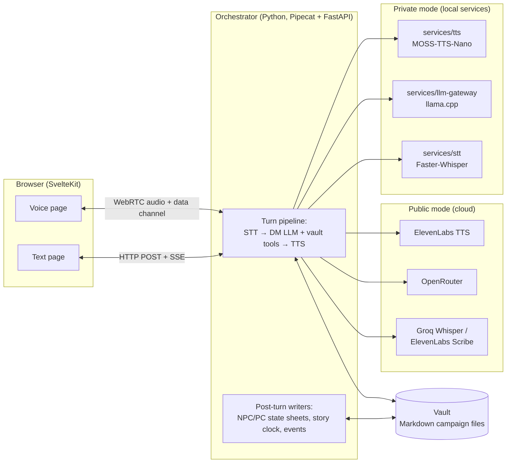

# AIDM: a voice-first AI Dungeon Master

AIDM runs a tabletop role-playing session with one player. You speak (or
type), and an LLM Dungeon Master answers in character, in voice when you
use voice mode. The campaign world lives in plain Markdown files that the
DM reads and updates through tool calls while it plays.

It is a personal project and a working prototype, not a product. It has
two provider stacks:

- **Public mode:** cloud services. Groq Whisper or ElevenLabs Scribe for
  speech-to-text, any OpenRouter model as the DM (default
  `anthropic/claude-sonnet-4.5`), ElevenLabs for text-to-speech.
- **Private mode:** everything local. Faster-Whisper, a llama.cpp server
  running a GGUF model (default Qwen3-14B instruct), and MOSS-TTS-Nano.

Mode and transport are chosen at startup (`AIDM_MODE`, `AIDM_TRANSPORT`),
not per request.

## Architecture



There are three transports. `webrtc` serves the browser voice client,
`text` serves the browser chat client over HTTP and Server-Sent Events,
and `local` is a command-line loop using the machine's microphone and
speakers.

## Key engineering decisions

- **The vault is the memory, and it is navigated, not embedded.** There
  is no vector database. The DM gets filesystem-style tools
  (`vault_list_dir`, `vault_read_file`, `vault_grep`, `vault_glob`) and
  write tools (`vault_update_npc`, `vault_set_scene`,
  `vault_write_session_log` and others) over a predictable folder layout.
  Frontmatter has a schema (`services/orchestrator/aidm/vault_schema.py`)
  and a linter that runs in `make check`. See [`vault/README.md`](vault/README.md).
- **Code decides, the model narrates.** Time and authored story events
  are deterministic: a run's `clock.md` and `events/*.md` are advanced and
  fired by code, and the DM only receives the result as an instruction to
  narrate. The doc is explicit about what the runtime does *not* do (it
  never interprets NPC goals). See
  [`docs/deterministic-storytelling.md`](docs/deterministic-storytelling.md).
- **Volatile character state lives beside the identity sheet.** Each NPC
  and player character has a `<slug>.state.md` (mood, goal, location,
  recent events) that a post-turn writer patches every turn. The prompt
  keeps only the last 12 player turns of chat history; anything older
  reaches the model through these sheets.
- **Local-model output is guarded.** The llama.cpp provider runs stream
  guards (stock-phrase tics, looped paragraphs, replayed content,
  restating the player's turn) and an LLM judge for repeated content.
  Each guard can be switched off per model profile
  (`services/llm-gateway/profiles/`) so a model can be measured with and
  without it.
- **A text turn can be regenerated with a full rollback.** Before a turn
  runs, the server snapshots the LLM context, scene registry and director
  state and opens a write journal on the vault, so regenerating restores
  every file the turn touched (`aidm/turn_rollback.py`).
- **Sessions survive short disconnects.** A dropped browser connection
  gets a 5 second grace period to reconnect into the same context. See
  [`docs/session-lifecycle.md`](docs/session-lifecycle.md).
- **The containerised private stack has no internet egress.** In the
  private Docker Compose profile the orchestrator container is attached
  only to an `internal: true` network, so an accidental cloud call fails
  instead of leaking a transcript. (The LLM gateway also joins a bridge
  network so its port can be published on 127.0.0.1, and the
  `make start-private-*` dev loop runs the orchestrator on the host, so
  this guarantee covers `make up-private` only.)
- **The public deployment refuses an open posture.** Without
  `CF_ACCESS_DISABLED=1` the server will not start unless a CORS origin
  allowlist and Cloudflare Access JWT verification are configured. It
  also enforces per-IP rate limits, per-session token and TTS character
  caps, and a daily spend cap stored in SQLite (`aidm/web_security.py`,
  `aidm/budget.py`).
- **Rendered Markdown is sanitised.** Character sheets and DM replies can
  come from the model or from the vault write API, so the web client
  runs every `marked` render through DOMPurify before it reaches the page
  (`web/src/lib/markdown.ts`).
- **English for new work, Hungarian kept working.** See
  [`docs/decisions/english-only.md`](docs/decisions/english-only.md).

## How latency is measured

In the voice transports, Pipecat's `UserBotLatencyObserver` logs one line
per turn at `INFO` level: the time from the end of the player's speech
(VAD stop) to the first audio from the bot, plus a per-stage breakdown
(`aidm/observers.py`). The targets are under about 2 s in public mode and
a p50 under 3.5 s in private mode on a 16 GB consumer GPU. The method and
targets are in [`docs/latency-poc.md`](docs/latency-poc.md) and
[`docs/latency-private.md`](docs/latency-private.md); their result tables
are not filled in, and this repo publishes no latency results.

## How it is evaluated

- **`make check`:** ruff, mypy (strict), pytest, the vault schema lint,
  and for the web client `svelte-check`, the vitest unit tests
  (`npm test`) and a production build.
- **Tool-call gate, `make bench-tools`:** a fixed set of prompts
  (`scripts/fixtures/`) is sent to the local model, and the run passes
  only if at least 85% pick the right tool and at least 75% pass the
  argument checks.
- **Transcript replays, `make bench-regress`:** scripted player
  transcripts (`services/orchestrator/scripts/eval_transcripts/`) are
  replayed several times each against the configured model and scored against
  YAML assertions. Deterministic assertions must hold on every replay;
  behavioural ones need a pass rate above a threshold.
- **Closed-loop play, `make loop-sim-smoke` (5 turns) up to
  `make loop-sim-50`:** the real text server plays the demo campaign's
  `eval` run while a second model plays the character from its sheet and
  a beat script (`scripts/loop_scenarios/`). The simulator is an Anthropic
  model by default, an OpenRouter model, or a local Gemma 3 4B on CPU
  (`--sim-model local`, Compose profile `eval`). Every turn, the side-band
  events and a final vault snapshot are saved.
- **Scoring a replay, `make judge-run REPLAY=<dir>`:**
  `loop_score.py` computes a deterministic score out of 100
  (duplication, assistant-voice phrases, ungrounded names, tool errors,
  reply-length trend, NPC goal health, event-engine checks), and
  `judge_run.py` runs an LLM judge (`claude-opus-4-8`) in 2–3 passes,
  takes the per-axis median, and requires quoted evidence for every
  deduction. `--export-prompt` writes the judge prompt to a file instead
  of calling the API.

The bench and loop targets need a running model and, for the cloud
simulator and judge, an API key. Their output goes to `docs/bench/`,
which is git-ignored.

## Running it

Requirements: Python 3.12 or 3.13 with [uv](https://docs.astral.sh/uv/),
Node.js with npm, and for the Docker paths Docker Compose (plus the
NVIDIA Container Toolkit for the GPU containers).

```sh
cp .env.example .env
echo "CF_ACCESS_DISABLED=1" >> .env   # local development: no Cloudflare Access
make sync          # Python workspace
make web-install   # web client
make check         # optional: lint, types, tests, vault lint, web tests and build
```

The `make start-*` targets bind the orchestrator and the web dev server
to `127.0.0.1` only, because with `CF_ACCESS_DISABLED=1` the API has no
authentication. Reaching them from another device on the LAN or a VPN is
an explicit opt-in, set in the shell rather than in `.env`:
`AIDM_SERVER_HOST=0.0.0.0 make start-private-text` (any `start-*`
target).

The repo ships one campaign, **Ember Hollow** (`vault/ember-hollow/`), a
short original fantasy one-shot. Its `default` run has no character yet,
so the first session starts with character creation. The `eval` run
starts with a ready-made character, Rowan, at the village inn.

### Text mode with a local model

1. Download the default model (about 10.5 GB):

   ```sh
   uv tool run --from huggingface_hub hf download Qwen/Qwen3-14B-GGUF \
       Qwen3-14B-Q5_K_M.gguf --local-dir ./models/qwen3
   ```

2. Start the llama.cpp gateway container, the orchestrator and the web
   dev server together (`Ctrl+C` stops all three):

   ```sh
   make start-private-text
   ```

3. Open <http://localhost:5173/text>, pick *Ember Hollow* and a run, and
   start typing.

Without Docker or an NVIDIA GPU, any OpenAI-compatible server with tool
calling works, for example a locally built llama.cpp `llama-server`
with the flags the gateway container uses
(`services/llm-gateway/entrypoint.sh`). Point the orchestrator at it and
start the two processes yourself:

```sh
llama-server -m ./models/qwen3/Qwen3-14B-Q5_K_M.gguf --port 8002 --ctx-size 16384 \
    --jinja --chat-template-kwargs '{"enable_thinking":false}' --reasoning-budget 0 &
AIDM_MODE=private AIDM_TRANSPORT=text \
AIDM_LOCAL_LLM_URL=http://127.0.0.1:8002/v1 uv run aidm &
npm --prefix web run dev
```

### Voice mode with cloud providers

1. Put `GROQ_API_KEY`, `OPENROUTER_API_KEY` and `ELEVENLABS_API_KEY` in
   `.env` (public mode requires all three at startup).
2. Run `make start-public-voice` and open <http://localhost:5173>. The
   browser asks for microphone access.

Browsers only allow the microphone on `localhost` or over HTTPS, so voice
from another device needs TLS. `make stop` kills everything that is left
running. `services/orchestrator/README.md` lists the runtime settings.

### Deployment

`docker-compose.prod.yml`, `deploy/` and `deploy.sh` describe a
single-VPS public-mode deployment behind nginx, Let's Encrypt and
Cloudflare Access. Domains and addresses are placeholders
(`aidm.example.com`); see [`deploy/README.md`](deploy/README.md).

## Repository layout

```
services/
  orchestrator/          Python package `aidm`: pipeline, providers, servers, vault tools
    aidm/                runtime code
    prompts/             DM persona prompts (English, Hungarian; play and session zero)
    scripts/             eval tooling: replays, closed loop, scoring, judge, vault lint
    tests/               pytest suite
  llm-gateway/           llama.cpp server image, entrypoint, model profiles, chat templates
  stt/                   Faster-Whisper HTTP service (private mode)
  tts/                   MOSS-TTS-Nano WebSocket service (private mode)
web/                     SvelteKit client (Svelte 5, TypeScript): voice and text pages
vault/                   campaign vaults; ember-hollow is the shipped demo
scripts/                 dev start script, tool-call bench, rulebook importer, model fetch
docs/                    design notes, latency method, decision records
deploy/                  nginx configs and certificate script for the VPS deployment
tests/                   repo-level tests: smoke test, dev start script bind address
```

## License

MIT, see [`LICENSE`](LICENSE).
